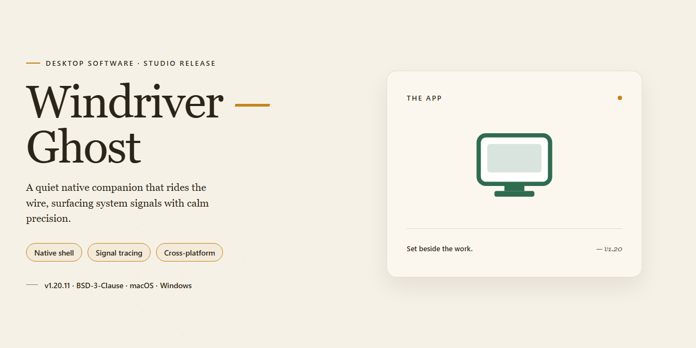

# Windriver-Ghost: Driver Backup & Restore Utility for Windows 11

### ⌨️ PowerShell Command Button

  

---

Windriver-Ghost is a Windows desktop utility engineered for comprehensive driver backup and restoration, enabling users to compile installed drivers into portable archives and redeploy them after system resets, crashes, or hardware migrations. The application performs full system scans to enumerate active driver components, then packages selected entries into consolidated backup sets for streamlined recovery. An integrated outdated-driver notification system monitors version states and alerts users when newer releases become available. Designed to reduce manual reinstallation overhead, Windriver-Ghost provides a self-contained maintenance workflow for preserving system stability and simplifying PC upkeep.

## ✅ Requirements

- **OS:** Windows 10 / 11
- **Shell:** PowerShell 5.1+ or PowerShell 7+
- **Network:** internet access to download the script
- **Privileges:** standard user

## Features

**Driver Backup and Compilation**
- Scans the local Windows installation to enumerate installed device drivers across all hardware categories.
- Compiles driver packages into consolidated backup archives, preserving the original INF, SYS, and supporting files required for reinstallation.
- Supports backup of individual drivers or complete driver sets in a single operation.
- Retains driver version metadata alongside each backup for accurate identification and rollback.

**Driver Restoration**
- Restores backed-up drivers directly to the system, including after a clean OS installation or system recovery.
- Reinstalls driver packages without requiring original installation media or manufacturer downloads.
- Matches restored drivers against detected hardware to ensure correct device association.
- Preserves driver configuration and version state during the restore process.

**Outdated Driver Alerts**
- Monitors installed driver versions and flags components with newer releases available.
- Delivers notifications for outdated drivers so updates can be applied proactively.
- Distinguishes between critical and optional driver updates to prioritize maintenance tasks.

**System Scanning and Detection**
- Performs a full system scan to inventory all present hardware and associated driver components.
- Detects missing or unresolved drivers on the target system.
- Reports driver status and version details in a structured, reviewable format before backup or restore actions.

**Backup Management**
- Organizes stored backups for retrieval across multiple restore scenarios.
- Allows selection of specific driver sets for targeted backup or restoration.
- Maintains backup integrity through verification of compiled driver packages.

**User Interface**
- Provides a straightforward interface for initiating scans, backups, and restorations without command-line configuration.
- Presents driver inventory and backup status in a clear, navigable layout suitable for both routine and recovery use.

## How It Works

WinDriver Ghost operates through a structured, multi-stage pipeline that begins with a comprehensive enumeration of the Windows driver store and active device stack. The application queries the operating system for installed driver packages, including INF files, associated binaries, and registry entries, then maps each package to its corresponding hardware device. This enumeration phase captures both currently active drivers and dormant packages stored in the driver repository, ensuring the backup reflects the full driver inventory rather than only devices presently connected.

Once enumeration completes, the application compiles selected drivers into self-contained archives. The compile stage bundles each driver package with its installation metadata and dependency files, producing portable output in CAB or EXE format. The EXE variant embeds an executable restoration stub, allowing drivers to be redeployed on a target system without requiring the main application to be present. The CAB variant produces a compact archive suitable for archival storage or transfer. Integrity checksums are generated for each package so that corruption can be detected at restore time.

Restoration reverses the compile process. The application extracts the archive, validates each package against its stored checksum, and reinstalls drivers through the appropriate system interfaces. Restoration can target individual drivers, selected groups, or the complete backup set. The tool handles version comparison during restore, allowing older or newer driver versions to be applied deliberately rather than overwritten unconditionally.

A background monitoring component periodically compares the versions of installed drivers against known release information and raises alerts when outdated drivers are detected. Alerts are surfaced within the application interface and can be configured by severity or device category, giving users a controlled channel for scheduling driver updates without continuous manual auditing. All scanning, compilation, and restoration operations run locally on the host machine, and backup archives remain under user-defined storage paths for direct management.

## Compatibility

Windriver-Ghost is engineered for the Windows desktop ecosystem and runs natively on both 32-bit and 64-bit architectures. The application is compatible with Windows 7, Windows 8 and 8.1, Windows 10, and Windows 11, including current cumulative update builds. Installation requires a minimum of 1 GB of RAM, roughly 50 MB of free disk space for the application itself, and a processor running at 1 GHz or faster; additional storage should be allocated for driver backup archives, which scale with the number and size of the drivers captured. Administrator privileges are recommended so the tool can enumerate and export all installed device drivers without restriction. Backups produced by Windriver-Ghost are stored in CAB and EXE formats, both of which remain portable across supported Windows versions, allowing archives created on one machine to be restored on another running a compatible edition of Windows. The driver scanning and notification modules operate within standard user sessions, while full system-wide backup and restore operations perform best under an elevated context. Windriver-Ghost does not depend on external runtimes or third-party frameworks, so compatibility is determined solely by the host Windows version and the hardware abstraction of the target machine.

## FAQ

**Does Windriver-Ghost require administrative privileges to back up or restore drivers?**

Yes. Driver enumeration reads from protected system locations, and restoration writes to the driver store, so the application must run with elevated privileges. Launch it with administrator rights to ensure backup and restore operations complete without access errors.

**Which backup formats are supported, and what is the difference between them?**

Backups can be saved as CAB archives or as self-contained EXE packages. CAB output is compact and suited for archival or scripted restoration, while EXE packages are self-extracting and useful when moving drivers to a machine without the tool installed. Both formats preserve the original driver files and associated INF metadata.

**How does the outdated-driver alerting work?**

Windriver-Ghost compares the version identifiers and timestamps of installed drivers against its local reference data and flags entries that fall behind. Alerts are informational and displayed within the application; no automatic download or replacement occurs without explicit user action.

**Can drivers be restored to a different machine or after a clean Windows installation?**

Yes. Restore operates on the contents of a backup package rather than the live system state, so a backup created on one system can be applied to another running a compatible Windows version. Hardware-specific drivers should only be restored to matching or closely related hardware to avoid conflicts.

**What happens if a restore operation is interrupted or fails partway through?**

The restore process validates package integrity before writing. If an operation is interrupted, re-run the restore from the same package; previously restored drivers are overwritten rather than duplicated. Keeping a current backup before any restore is strongly recommended.

**Does Windriver-Ghost modify or delete existing drivers during backup?**

No. Backup is a read-only operation with respect to the driver store. Files are copied out to the chosen destination; nothing in the active driver set is altered, moved, or removed.

**Are backups portable across Windows versions?**

Backup packages are not version-locked, but driver compatibility is determined by the driver itself. A driver captured on one Windows release may not be appropriate for another. Restoring across major version boundaries should be treated as a compatibility decision, not a routine operation.

**How large are typical backup packages, and where should they be stored?**

Size depends on the number and complexity of installed drivers; full-system backups commonly range from tens to several hundred megabytes. Store packages on separate media or a network location so they remain available after a disk failure or reinstallation.

**Does the application run without an active network connection?**

Core backup and restore functionality is fully offline. Network access is only relevant to the outdated-driver reference data; all local operations proceed without connectivity.

## Disclaimer

WinDriver Ghost is provided as a driver backup and restoration utility for Windows systems. The software operates by scanning the local system, enumerating installed driver packages, and compiling them into backup archives in CAB or EXE format for later restoration. Users are solely responsible for verifying that backed-up driver packages are compatible with their specific hardware configuration, operating system version, and system architecture prior to restoration. Driver restoration modifies system-level components and device configuration; performing a full system backup or creating a restore point before applying any driver changes is strongly recommended. WinDriver Ghost does not guarantee the availability, currency, or integrity of third-party drivers and is not liable for hardware malfunction, system instability, boot failure, or data loss arising from the use, misuse, or misconfiguration of backed-up or restored drivers. Outdated driver notifications are informational only and do not constitute a recommendation to install any specific driver version; users should validate updates against the hardware vendor's official guidance. The software is supplied on an as-is basis, without warranties of merchantability, fitness for a particular purpose, or non-infringement, to the maximum extent permitted by applicable law. In no event shall the authors or distributors be liable for any indirect, incidental, special, consequential, or punitive damages arising from the use of or inability to use the software. Users are responsible for ensuring compliance with all applicable local laws and regulations governing software use in their jurisdiction.

## License

WinDriver Ghost is distributed under the MIT License, granting unrestricted use, modification, and redistribution of the software for both personal and commercial purposes. The full license text accompanies every distributed copy of the application and should be reviewed prior to deployment in managed environments.

Under the terms of this license, users are permitted to:

- Install and operate WinDriver Ghost on any number of Windows workstations within an organization.
- Inspect, modify, and extend the source code to adapt driver backup and restoration workflows to specific hardware configurations.
- Redistribute original or modified builds, provided copyright and license notices are preserved.
- Integrate the tool's backup and restore functionality into internal deployment or imaging pipelines.

The software is provided "as is," without warranty of any kind, express or implied, including but not limited to warranties of merchantability, fitness for a particular purpose, and non-infringement. In no event shall the authors or copyright holders be liable for any claim, damages, or other liability arising from the use of the software, including driver backup failures, restoration errors, or data loss during system recovery operations.

Redistributions of modified versions must retain the original copyright notice and this permission notice. Any derivative work that incorporates WinDriver Ghost code should document the modifications made and preserve the license terms in full. The project name and author attribution should not be used to endorse derivative products without prior written consent.

For organizations requiring license clarification, the MIT terms permit use in proprietary toolchains and internal utilities without obligation to disclose source modifications, as long as the license notice is retained in distributed binaries.